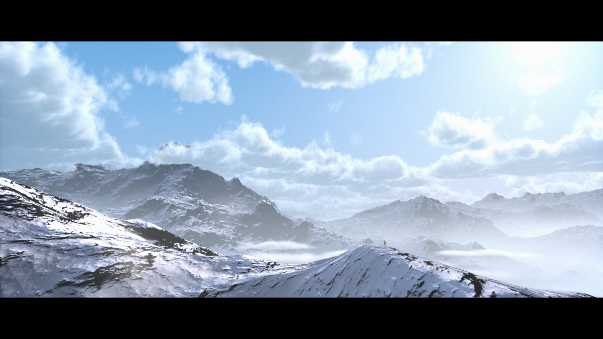

# Himalayas

Native DirectX 11, DirectX 12 and Vulkan ports of
[Himalayas by Reinder Nijhoff (2018)](https://www.shadertoy.com/view/MdGfzh).
The scene retains the mountains, both volumetric cloud layers, cloud shadows,
temporal reprojection, humanoid, lens flare, color grading and letterboxing.



## Build and run

Each API has a `07_Himalayas/GraphicsDemo.sln`. Open it in Visual Studio 2019,
choose Debug or Release / Win32, and press F5. Each `BuildSmall.bat` creates
`build/Release/Intro.exe` through shared Crinkler 3.0b. From the repository root:

```powershell
.\Build.ps1 -Project 'DirectX 11\07_Himalayas' -Configuration All -Compress
.\Build.ps1 -Project 'DirectX 12\07_Himalayas' -Configuration All -Compress
.\Build.ps1 -Project 'Vulkan\07_Himalayas' -Configuration All -Compress
```

All versions use an x86 custom entry point without CRT startup or imports.
DirectX embeds compact HLSL and compiles it at startup with D3DCompiler_47;
the Vulkan build embeds SMOL-V and restores compiled SPIR-V at startup.
Shaders and textures require no external files. Keep LICENSE-Himalayas.txt
and, for Vulkan, license-smolv.txt with the executable.

The camera is free-moving and playback continues until Escape or window close.
Hold the right mouse button to look; use WASD to fly, Q/E to descend/ascend,
Shift for four times the speed, and R to reset the starting view. Normal speed
is 100 metres per second. Movement is frame-rate independent, stops when the
window loses focus, and has no terrain-following or collision constraint.

Both cloud layers now move through their density fields: upper clouds drift
at (12, 0, 4) metres per second, and lower clouds at half that speed. Cloud
self-shadow sampling follows the wind. Cloud layers and height fog stay at
world-space heights when the camera ascends or descends. Temporal history
reprojects camera and cloud motion and resets after R or a long frame gap.

All three versions target **120 FPS** with a shared high-resolution waitable
timer and performance-counter clock. DirectX presents with sync interval zero;
Vulkan prefers mailbox, then immediate presentation, with FIFO as a fallback.
Rendering pauses while minimized, but elapsed time continues. The internal
resolution stays 1280x720; all sampling, iteration counts and texture precision
are retained. Actual performance depends on the view, GPU and presentation
support; a slower display cannot show 120 distinct refreshes per second.
The high-resolution timer is supported on Windows 10 1803 and later; older
Windows falls back to a normal waitable timer with less precise pacing.
See [Windows timer documentation](https://learn.microsoft.com/en-us/windows/win32/api/synchapi/nf-synchapi-createwaitabletimerexw)
and [Vulkan presentation modes](https://docs.vulkan.org/refpages/latest/refpages/source/VkPresentModeKHR.html).

Measured VS2019/v142 builds, Crinkler 3.0b, full 32-bit constants:

| API | Ordinary Release EXE | Packed before camera/wind | Current packed | Compression mode |
| --- | ---: | ---: | ---: | --- |
| DirectX 11 | 22,528 B | 5,728 B | 6,660 B | SLOW |
| DirectX 12 | 24,576 B | 6,458 B | 7,404 B | VERYSLOW |
| Vulkan | 51,712 B | 15,328 B | 16,308 B | FAST |

`BuildSmall.bat` and `Build.ps1 -Compress` select those modes automatically.
An explicit `-CompressionMode` overrides the project choice. These modes were
selected during the earlier compression experiments; stronger model search
was not always smaller. Current sizes include the free camera, moving clouds,
altitude corrections and 120 FPS pacing.

### Size optimization and the 4 KiB target

These builds **do not reach 4,096 bytes** with the complete scene retained.
Before adding the camera, wind and frame pacing, the size-only changes reduced
the original ports from 8,030 / 8,831 / 15,781 bytes to 5,728 / 6,458 / 15,328
bytes for DX11 / DX12 / Vulkan. The extra interactive features increase size.

The DirectX hosts now embed `Bundle.hlsl` as one compact source string with
five entry points. Common functions and declarations are stored once, and
identifier shortening is consistent across the passes. The build validates
all five entry points against their unminified bytecode. Resource-access
macros shorten the source without changing the compiled rendering code.

Vulkan retains SMOL-V and reuses static descriptor-initialization structures.
Compiler size recipes, preserved SPIR-V functions, compacted IDs and alternate
Crinkler settings were measured as complete EXEs. Those shader variants did
not beat the selected build. More aggressive HLSL minifier outputs failed
compilation and were rejected. No extra runtime compiler or data DLL was added.

The remaining shader payload is substantial: the DX12 compression report
attributes over 4 KiB to the shader source alone, before the native host and
decompressor. The current optimizations do not establish a path below 4 KiB
without a further algorithmic rewrite; no visual cuts were made for this target.

## Source and adaptation

`Original/` preserves the author's GLSL, credits and channel configuration,
downloaded from the [author's repository](https://github.com/reindernijhoff/shadertoy/tree/2def3ce132b4f5d9590e9eee0c17bd37a011835c/himalayas).
Readable HLSL is shared here by all three APIs. The small API folders contain
native resource management, synchronization and project files.
`Bundle.hlsl` only combines the five DirectX passes; each pass remains editable
in its original HLSL file. Vulkan continues to compile the passes separately.

- A and B generate the original procedural cloud lookup textures once. Their
  size is fixed, so the original resolution-change regeneration is unnecessary.
- C renders terrain with previous C/D history; D renders both cloud layers
  using current terrain and previous D history; Image composites the result.
- C/D use alternating RGBA32F images. A/B also retain full RGBA32F precision,
  original sampling and noise octaves. Final output is RGBA8.
- Original iteration counts are retained: 128 terrain steps, 15 normal
  octaves, 12 cloud steps, 6 shadow steps and 3x3 humanoid antialiasing.
- GLSL column matrices are represented by HLSL rows with explicit `mul`
  order. Intermediate coordinates retain ShaderToy's bottom-up convention;
  only the final output is vertically flipped for presentation.
- Camera metadata contains the previous view, resolution, time and reset
  epoch, with all metadata fetched at mip 0. Unused metadata is zeroed.
- Cloud intersections support cameras below, inside and above either layer.
  History positions use the shader's ten-metre scene units, including the
  wind offset. Fog integration handles horizontal and downward views, and
  lens flare is skipped when the sun lies behind the camera.

The build verifies byte-identical stripped shader bytecode before and after
DirectX source compaction. Vulkan verifies exact SPIR-V round trips through
both SMOL-V decoders. No rendering detail or floating-point constants are
truncated for executable compression.

## Verification

Tested on an AMD Radeon RX 9070 XT with VS2019 14.29 and Windows SDK
10.0.22621.0. Each API rendered 64-frame sequences at the initial view, a moved
and rotated view, above the upper clouds, inside the upper clouds, and inside
the lower clouds. Another sequence exercised movement, rotation and reset.
Direct3D debug layers and Vulkan validation with synchronization checking
reported zero errors and warnings. DX11 terrain/cloud float readbacks also
contained no non-finite values in these views.

DX11 and DX12 readbacks are byte-identical for all five fixed poses. Vulkan's
mean absolute RGBA differences range from 0.667 to 2.309 on a 0-255 scale;
compiler/driver math differs while all quality settings are retained. A fixed
camera comparison at 1 and 10 seconds, with identical ray jitter, changes
238,309 output pixels and verifies actual cloud motion. CPU checks cover
camera speed, boost, focus loss, pause limits, diagonal speed, pitch and reset.

The actual rendering/presentation loops, instrumented for timing in Release,
measured 120.00 FPS (DX11), 119.67 FPS (DX12) and 119.99 FPS (Vulkan) over 600
frames after 60 warm-up frames at the initial view. This measures application
frame cadence, not the number of distinct frames scanned out by the monitor.

All three APIs build in Debug and Release and retain the custom x86 `winmain`
entry point with no CRT DLL imports. Ordinary builds pass close/Escape checks;
packed builds run beyond 30 seconds, pass minimize/restore, and exit on Escape.
Plain MSBuild/VS2019 builds use automatic installed-SDK selection. DirectX
source compaction and both SMOL-V decoders are verified during shader builds.

## License

The original shader and HLSL adaptations are **CC BY-NC-SA 4.0**. Preserve the
[attribution and license](LICENSE.txt), including the author's component
credits, when sharing source or executables. Adaptations are noncommercial
and use the same license.
